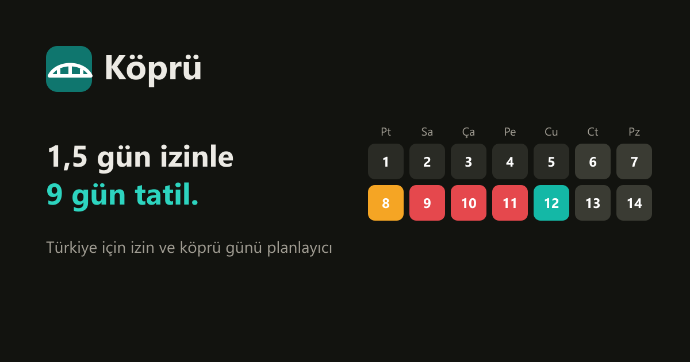

# Köprü

**Türkiye için izin ve köprü günü planlayıcı.** Yıllık iznini resmî tatillerle ve hafta sonlarıyla birleştirip en az izinle en uzun tatilleri yapmanı sağlar.

🔗 **https://necatimertmetin.github.io/kopru/**



> 2027'de **1,5 gün izinle 9 gün** Ramazan Bayramı tatili, **2 gün izinle 9 gün** Kurban Bayramı tatili.

## Neler yapar

- **Bana en iyi planı yap:** İzin hakkını gir (ör. 14 gün), yıl için en çok tatil gününü veren izin günlerini hesaplar. Üç strateji: *Uzun tatiller* (en az 9 gün), *Dengeli* (en az 5 gün), *En çok gün* (uzun hafta sonları dahil).
- **Yılın en iyi köprüleri:** Her bayram ve resmî tatil için en verimli seçenek ("1,5 gün izinle 9 gün tatil"), tek tıkla plana ekle.
- **Etkileşimli yıl takvimi:** Herhangi bir iş gününe dokunarak izin ekle/çıkar; tatil aralıkları anında hesaplanır.
- **Gerçek kurallar:** Arife günleri ve 28 Ekim yarım gün sayılır (0,5 gün izin). "Cumartesi de çalışıyorum" ve "Yarım gün izin kullanamıyorum" seçenekleri.
- **Paylaş ve takvime ekle:** Planı bir bağlantıyla paylaş (plan bağlantının içinde, sunucuya gitmez) ya da `.ics` olarak Google/Apple/Outlook takvimine aktar.
- **Sıradaki tatil** geri sayımı ve yılın resmî tatil listesi.

## Nasıl hesaplıyor

Her gün için izin maliyeti çıkarılır (iş günü 1, arife 0,5, tatil/hafta sonu 0). Her olası tatil aralığı, iki yanında birer iş günü olan kesintisiz bir izin bloğudur. Plan, bu adaylar arasından çakışmayan ve toplam izni bütçeyi aşmayan, toplam tatil gününü en çoklayan kümeyi seçer: bütçe boyutlu bir *ağırlıklı aralık seçimi* (dinamik programlama). Sonuçlar testlerde kaba kuvvet aramasıyla karşılaştırılır.

## Veri

- Resmî tatiller: 2429 sayılı Ulusal Bayram ve Genel Tatiller Hakkında Kanun.
- Dinî bayramlar: Diyanet İşleri Başkanlığı takvimi (2025–2027). 2028 tarihleri tahminidir ve `*` ile işaretlidir.
- Hükûmetin sonradan ilan ettiği idari izinler dahil değildir.

## Geliştirme

```bash
npm install
npm run dev      # http://localhost:5173/kopru/
npm test         # vitest
npm run build
```

React 19 + TypeScript + Vite, sunucu yok. `main`'e her push'ta GitHub Actions testleri çalıştırır ve GitHub Pages'e yayınlar.

## Lisans

MIT
